<p align="center">
  
</p>

<h1 align="center">意绘</h1>

<p align="center">让一个故事，从文字走向银幕</p>

<p align="center">
  <a href="https://github.com/ddcat-ai/open-ai-canvas">GitHub</a> ·
  <a href="docs/content/docs/overview/features.mdx">功能</a> ·
  <a href="docs/index.md">文档</a> ·
  <a href="SECURITY.md">安全策略</a>
</p>

意绘是一个开源的 AI 影视与短剧创作工作台。上传一本小说，流水线会完成改编、拆集、建角色、出分镜，再逐段生成视频并合成成片；需要自由发挥时，可以在无限画布上用节点组织图片、视频、文本和 3D 预演，也可以让 Agent 直接在画布上动手。模型渠道、技能、插件、素材和计费都可以自部署、自管理。

<p align="center">
  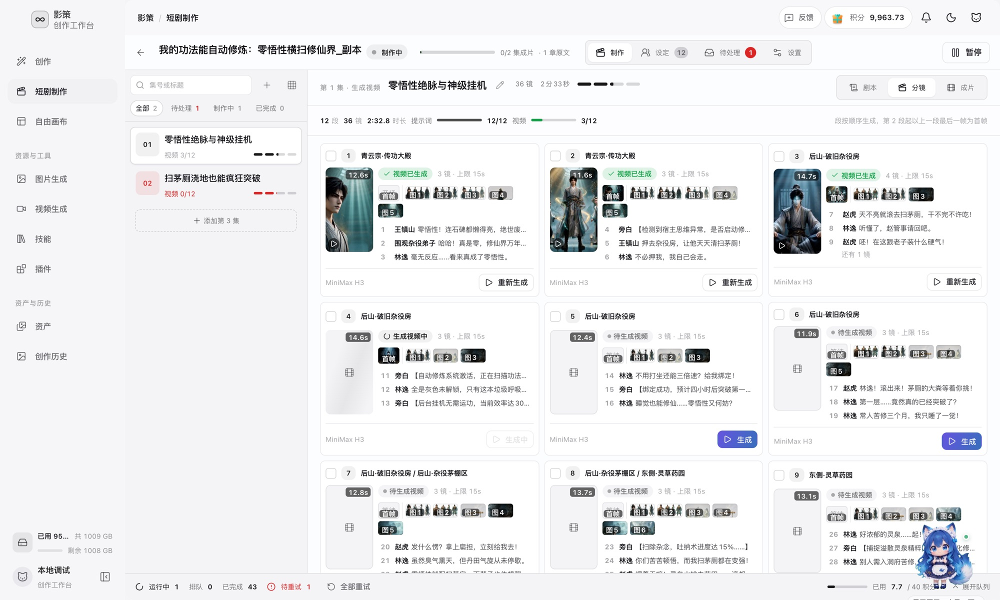
</p>

<p align="center">
  <a href="https://yingce.tv"><strong>在线演示 yingce.tv</strong></a> ·
  <a href="#快速开始">本地启动</a> ·
  <a href="#服务器部署">服务器部署</a>
</p>

> 项目仍在快速开发，数据结构和外部接口可能调整。默认适合个人、本地或可信环境部署；未经安全配置，不要直接作为公网多人服务使用。

## 下个版本：意绘世界引擎（内测中）

在 3D 世界里搭场景、排机位、做动画：天气、布景、建筑、花木和角色直接摆进场景，在地面标记 A、B 点后，用一句话告诉 Agent「将角色从 B 点跑步移动到 A 点」，它会补问细节并生成关键帧。镜头可在时间轴上编排，并导出白模和深度画面作为视频生成的参考。

<p align="center">
  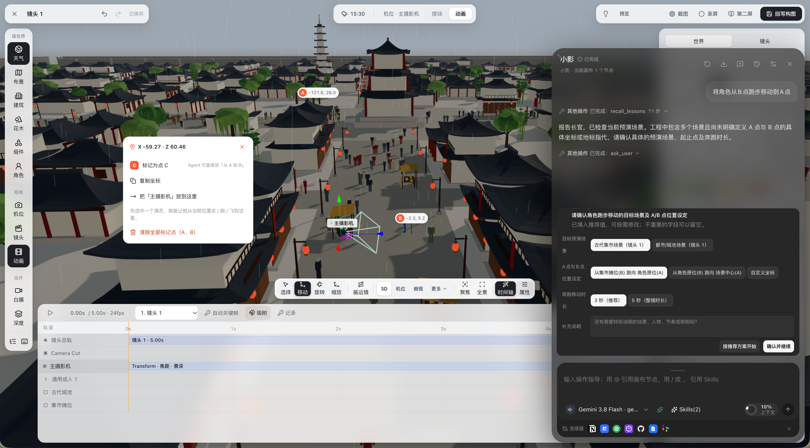
</p>

## 产品一览

### 从小说到成片：短剧制作流水线

上传小说或粘贴正文，意绘按集拆分剧本，提取角色、道具和场景，生成结构化分镜，再按剧情段逐段生成视频。第 2 段起自动以上一段最后一帧作为首帧，镜头之间保持连贯。每一步都可以人工接管：改写台词、锁定角色形象、单段重新生成。

<table>
<tr>
<td width="50%">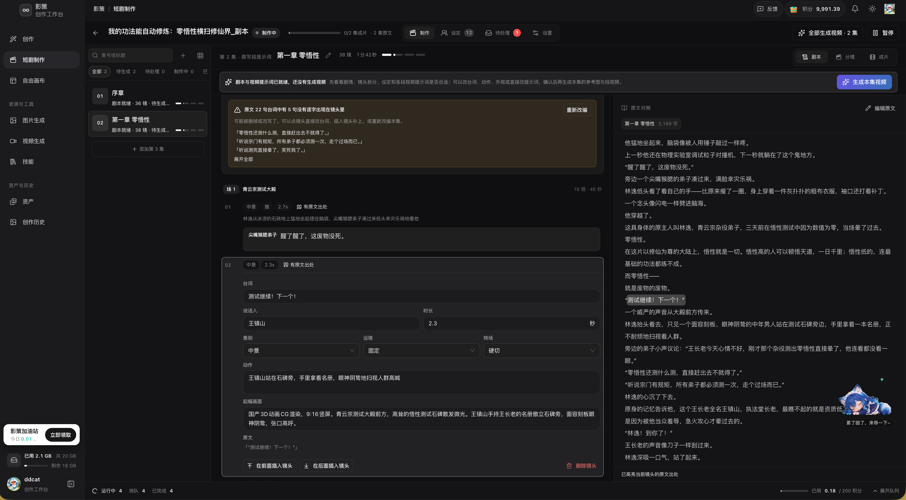</td>
<td width="50%">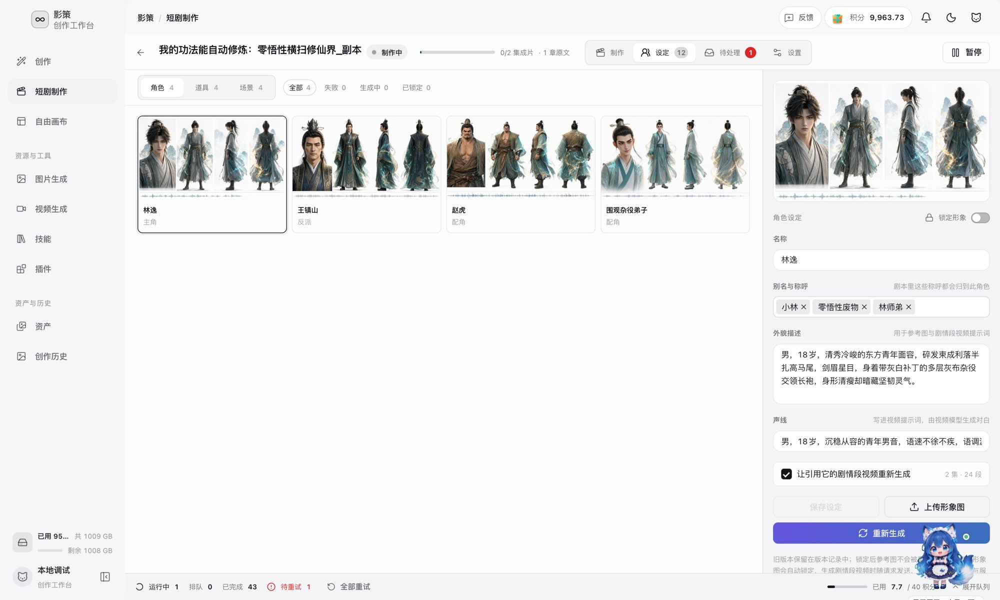</td>
</tr>
<tr>
<td><b>剧本</b>：本集梗概、开场钩子和结尾悬念一目了然；每个镜头标注景别、运镜和时长，右侧对照小说原文。</td>
<td><b>设定</b>：角色、道具、场景统一管理。角色有三视图、别名、外貌和声线，锁定后整部剧沿用同一形象。</td>
</tr>
</table>

### 一句话开始创作

创作首页把视频、图片、文本和 Agent 放在同一个输入框里。选模型、调比例和清晰度、加参考图，然后直接生成；灵感大厅收录可复用的提示词案例，点开即可继续创作。

<table>
<tr>
<td width="50%">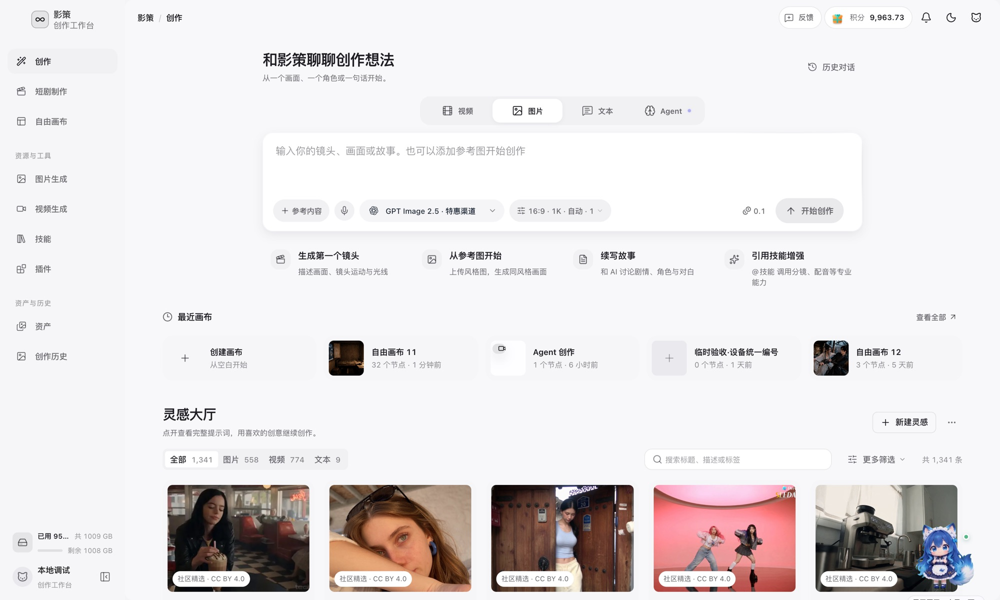</td>
<td width="50%">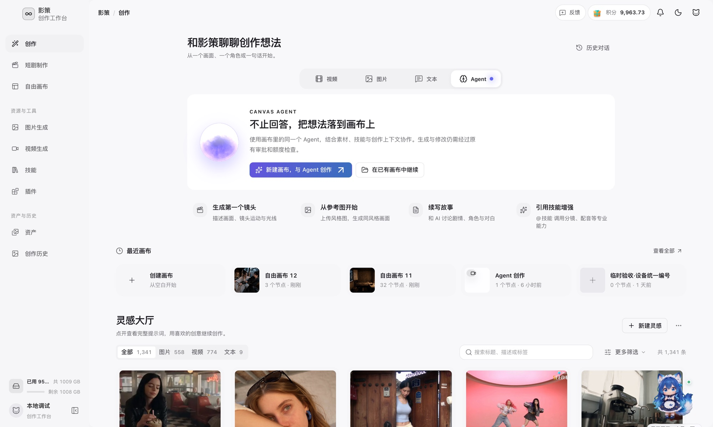</td>
</tr>
<tr>
<td><b>创作首页</b>：最近画布、快捷入口和灵感大厅集中在一页。</td>
<td><b>画布 Agent</b>：Agent 结合素材、技能和画布上下文直接在画布上生成和修改，生成操作仍需经过审批和额度检查。</td>
</tr>
</table>

### 无限画布

节点、连线、框选、小地图、撤销重做、导入第三方画布和只读分享都已就绪。图片、视频、文本、音频和 3D 预演节点可以互相引用，适合做角色设定、场景概念和镜头实验。

<p align="center">
  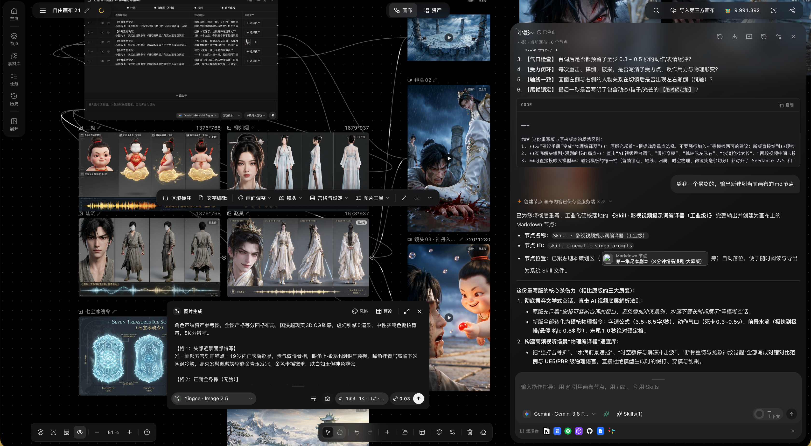
</p>

### 图片与视频工作台

按出品目标选模板（如商品白底图、广告英雄出场），上传参考素材，描述画面，确认参数后生成。进行中的任务和历史结果都在右侧。

<p align="center">
  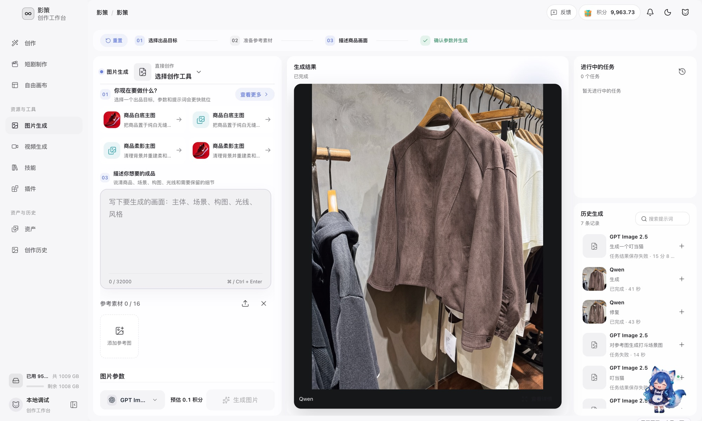
</p>

### 技能、插件与素材

<table>
<tr>
<td width="50%">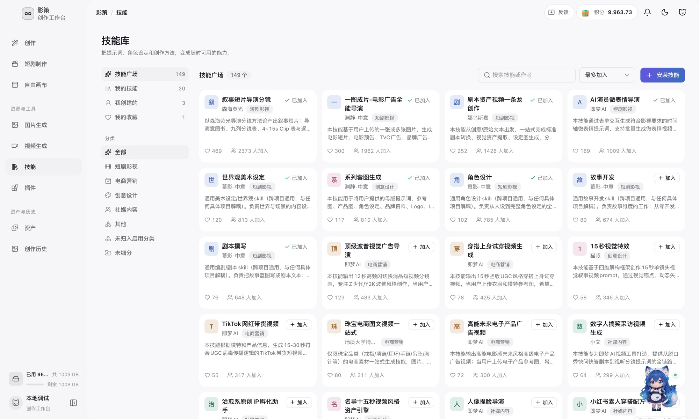</td>
<td width="50%">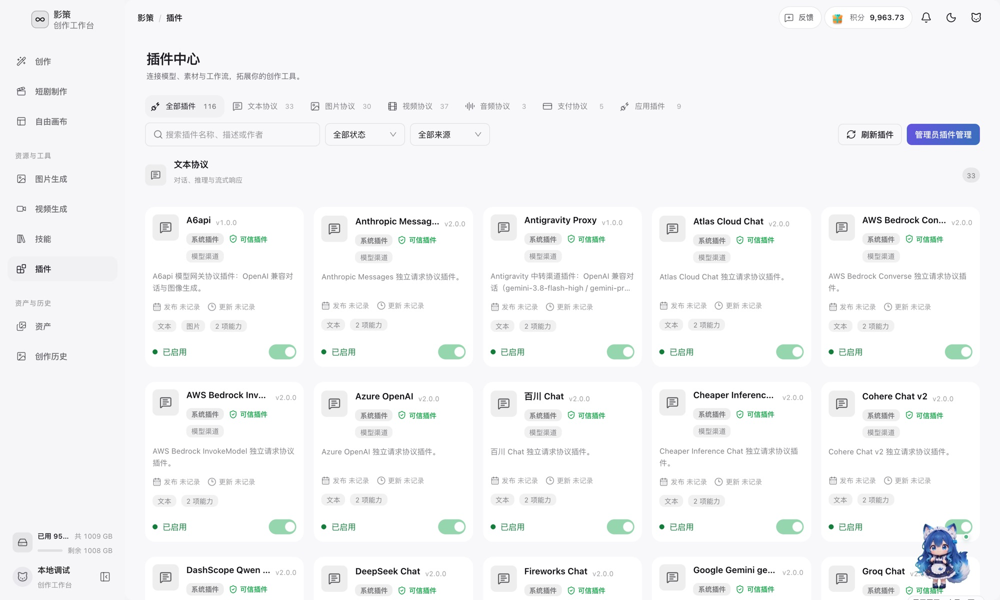</td>
</tr>
<tr>
<td><b>技能库</b>：把分镜方法、角色设计、广告导演思路等沉淀成技能，在对话里用 <code>@技能</code> 调用，也可以从 GitHub 安装社区技能。</td>
<td><b>插件中心</b>：模型协议以插件形式接入，覆盖主流文本、图片、视频、音频供应商，另有支付协议和应用插件。</td>
</tr>
<tr>
<td>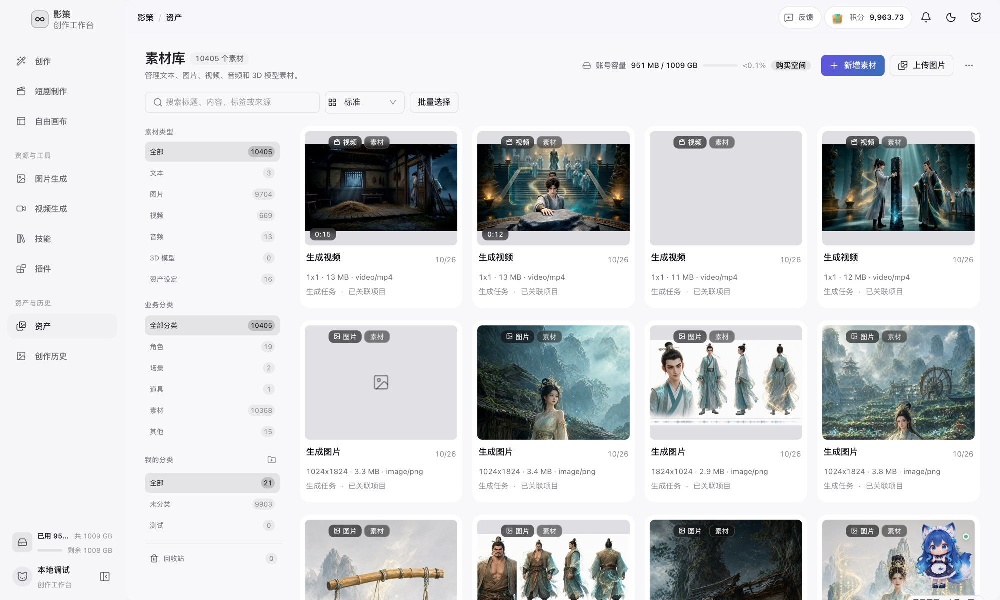</td>
<td>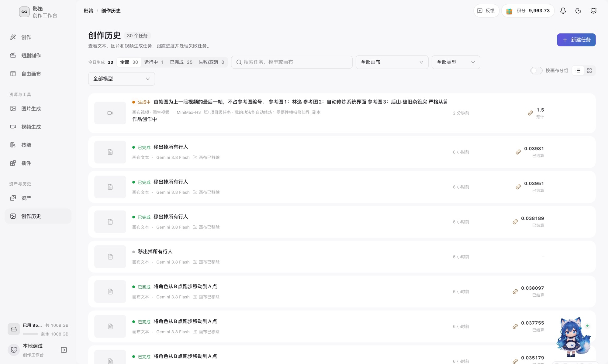</td>
</tr>
<tr>
<td><b>素材库</b>：文本、图片、视频、音频和 3D 模型统一归档，按角色、场景、道具分类，删除前检查引用。</td>
<td><b>创作历史</b>：所有生成任务的状态、模型、所属项目和积分消耗，可按画布、类型和模型筛选。</td>
</tr>
</table>

### 自部署管理后台

<table>
<tr>
<td width="50%">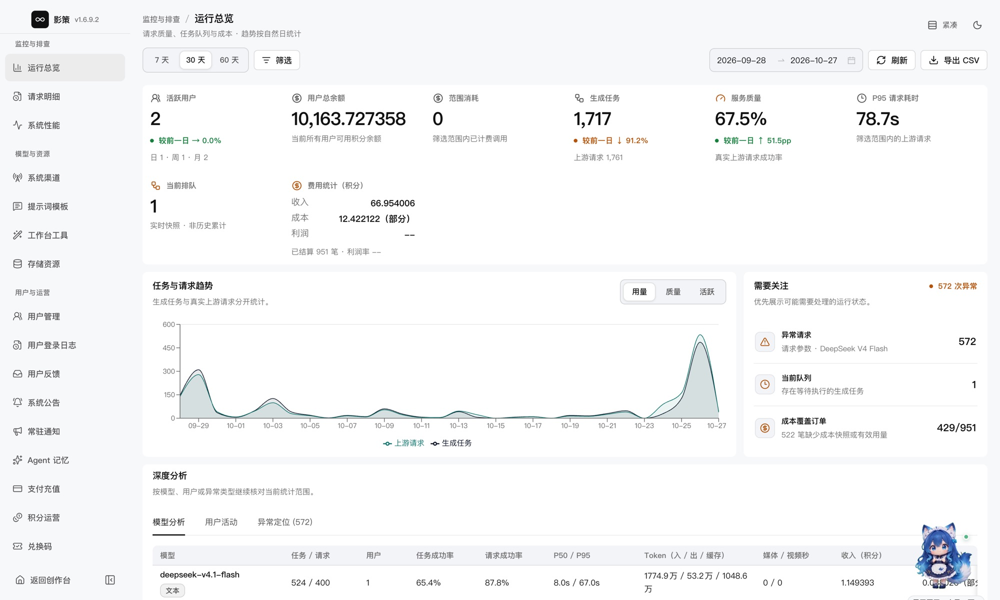</td>
<td width="50%">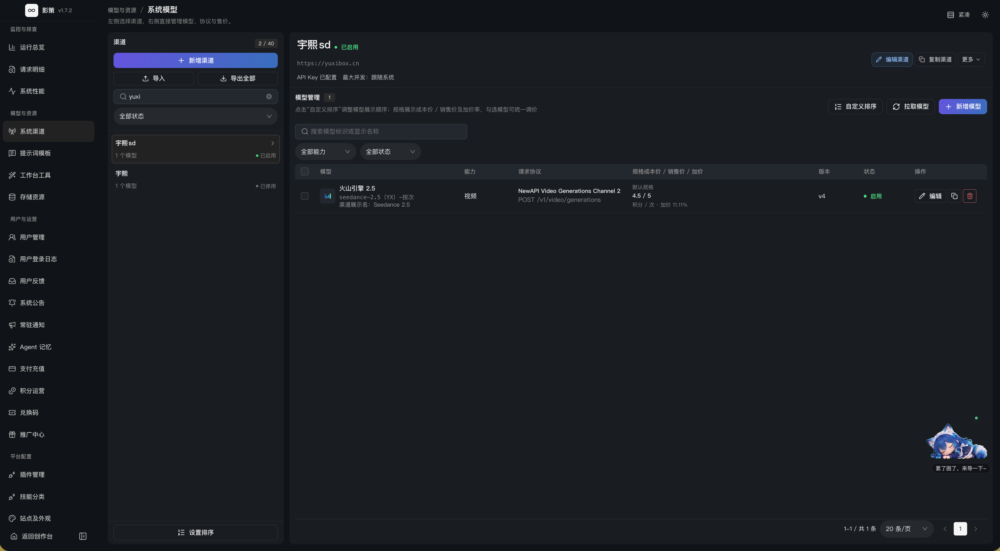</td>
</tr>
<tr>
<td><b>运行总览</b>：任务量、服务质量、P95 耗时、成本与收入，异常请求单独列出。</td>
<td><b>渠道与模型</b>：接入多个上游渠道，为每个模型配置请求协议、规格成本和售价。</td>
</tr>
</table>

后台还包括用户管理、登录日志、系统公告、提示词模板、存储资源、积分运营、兑换码和支付充值。

### 更多能力

- **时间线剪辑**：片段编排、拆分、修剪、字幕转写和服务端成片导出，支持插件化编辑面板。
- **3D 预演台**：从画布镜头节点打开，提供摆场、姿态、动画、摄影机与时间轴，可输出构图截图、白模视频和深度图。
- **任务系统**：异步队列、进度与日志、取消和重试，登录后跨设备同步。
- **存储**：媒体可存放在后端数据目录、阿里云 OSS 或腾讯云 COS。
- **明暗主题**：工作台支持明暗主题切换。
- **社区技能**：[judian-skills](https://github.com/itsWyatt-K/judian-skills) 提供 34 个场景域包索引。安装方式：技能页 → 安装技能 → GitHub 标签 → 仓库地址填 `https://github.com/itsWyatt-K/judian-skills`，子目录填 `skills/drama/story-structure-engine` 这类域包路径。

<p align="center">
  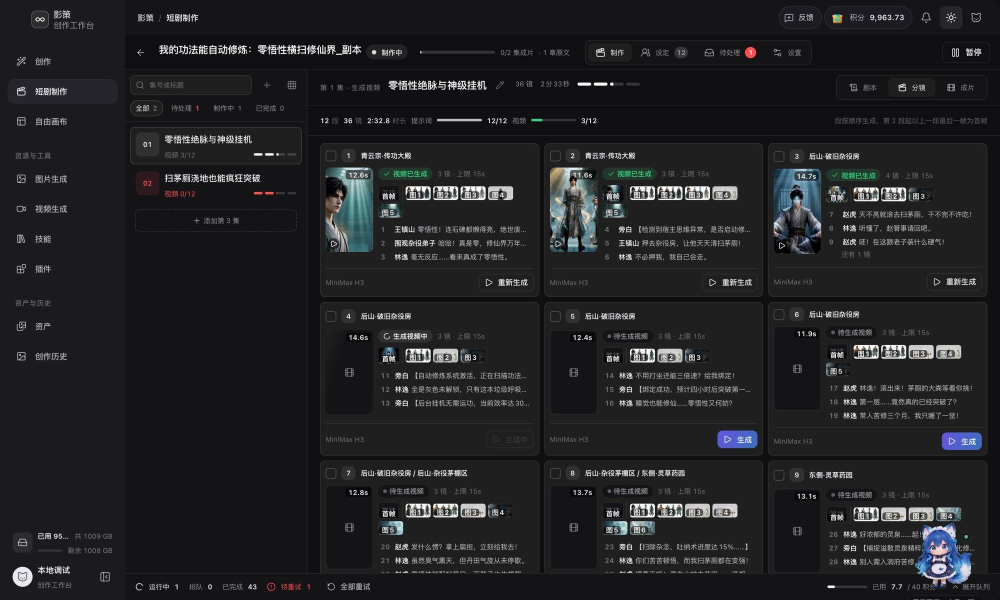
</p>

完整功能以[功能清单](docs/content/docs/overview/features.mdx)为准。

## 快速开始

### 环境要求

- [Bun](https://bun.sh/)：前端和文档站
- [Go 1.26](https://go.dev/)：后端
- Docker Compose：仅在使用容器开发或部署时需要

### 宿主机启动

```bash
git clone https://github.com/ddcat-ai/open-ai-canvas.git
cd open-ai-canvas

# 使用 Git 忽略的目录保存本地开发数据和缓存
mkdir -p .local/project-workbench-debug .local/cache/go-build .local/cache/go-mod

# 终端一：后端
cd backend
CANVAS_BACKEND_ADDR=127.0.0.1:8080 \
CANVAS_BACKEND_DATA_DIR=../.local/project-workbench-debug \
GOCACHE=../.local/cache/go-build \
GOMODCACHE=../.local/cache/go-mod \
go run ./cmd/server

# 终端二：前端
cd ../web
bun install --frozen-lockfile
bun run dev
```

打开 <http://localhost:3000>。首次使用时注册管理员账号，并在设置中配置模型渠道。前端默认将 `/api` 代理到 `http://127.0.0.1:8080`；如需修改代理目标，可设置 `VITE_API_PROXY_TARGET`。

Windows PowerShell 用户可在仓库根目录执行：

```powershell
.\scripts\start-local.ps1
```

### Docker 开发与本地构建

以下命令用于本地开发或试运行。部署服务器并使用后台在线更新，请使用下文的官方 Release 镜像部署。

源码热更新：

```bash
LOCAL_UID=$(id -u) LOCAL_GID=$(id -g) \
  docker compose -f docker-compose.dev.yml up --build
```

本地构建并运行 release 镜像：

```bash
docker compose -f docker-compose.local.yml up -d --build
```

热更新开发默认前端端口为 `3000`、后端端口为 `8080`；端口冲突时可通过 `CANVAS_WEB_HOST_PORT` 和 `CANVAS_BACKEND_HOST_PORT` 覆盖。本地构建编排只暴露 web 的 `3000`，后端留在容器网络内，不安装 Host Updater。

更多本地开发说明（包括时间线字幕转写）见[本地开发文档](docs/content/docs/backend/local-development.mdx)。

## 架构概览

```text
浏览器（web/）
  ├─ React 工作区、画布、任务中心和素材库
  ├─ Zustand / localForage 本地状态与降级缓存
  └─ 登录态 API、资源请求和 SSE
          │
          ▼
后端（backend/）
  ├─ Gin handler -> service -> repository/model
  ├─ SQLite（本地）或 PostgreSQL + Redis（部署）
  ├─ 异步任务 worker、权限、资源存储和模型中转
  └─ provider / outbound -> 外部模型渠道
```

前端业务 API 统一经 `web/src/services/api/request.ts` 调用。生产环境由 Nginx 托管前端并代理后端，公网只需暴露 web 入口；SSE 仅在明确的流式路径关闭代理缓冲。

## 服务器部署

### 官方 Release 镜像（推荐，支持后台在线更新）

适用于使用 systemd 的 Linux 服务器。先从 [GitHub Releases](https://github.com/ddcat-ai/open-ai-canvas/releases) 选择包含镜像、Host Updater 二进制和 `SHA256SUMS` 的已发布版本，将下方 `vX.Y.Z` 替换为该版本：

```bash
CANVAS_RELEASE=vX.Y.Z
curl -fsSL "https://raw.githubusercontent.com/ddcat-ai/open-ai-canvas/${CANVAS_RELEASE}/scripts/install-server-image.sh" \
  | sudo env CANVAS_IMAGE_TAG="${CANVAS_RELEASE}" REPOSITORY_REF="${CANVAS_RELEASE}" bash
```

脚本使用 `docker-compose.deploy.yml`，启动 PostgreSQL、Redis、独立 `yingce-agent`、backend 和 web，由一次性 `migrate` 服务迁移数据库，并安装宿主机 Host Updater。backend、web、Agent 镜像会固定为对应 GHCR digest。默认访问 `http://服务器IP:3000`，安装完成后在“系统配置 → 系统更新”检查后续版本。

查看状态和日志：

```bash
cd /opt/open-ai-canvas
sudo docker compose --env-file .env -f docker-compose.deploy.yml ps
sudo docker compose --env-file .env -f docker-compose.deploy.yml logs -f --tail=200
```

### 源码构建与已有部署

需要运行自行修改的源码时，可以使用源码安装脚本：

```bash
curl -fsSL https://raw.githubusercontent.com/ddcat-ai/open-ai-canvas/main/scripts/install-server.sh | sudo bash
```

脚本使用 PostgreSQL、Redis、独立 Agent 和源码构建叠加层，但不安装 Host Updater；该部署不属于后台在线更新管理范围，需自行构建、备份和升级。根目录的 `docker-compose.yml`、`docker-compose.local.yml` 和自行编写的两容器 SQLite 编排用于本地试运行，不作为默认服务器部署方案。

已有 SQLite 或自定义 Compose 部署，不能只替换 Compose 文件或补装更新器就获得在线更新；应先核对原数据卷、完成备份和数据迁移。方案选择见上文「官方 Release 镜像」与「源码构建与已有部署」，更新约束、备份和回退见[系统更新文档](docs/content/docs/backend/system-update.mdx)。

## 安全边界

- 首次管理员注册应在受控网络完成，公网部署保持 `CANVAS_REGISTRATION_ENABLED=false`。
- 设置准确的 `CANVAS_CORS_ORIGINS`，不要在公网使用 `*`；使用 HTTPS 并正确转发代理头。
- 后端默认拒绝本机、私网和链路本地模型地址。开发时只通过 `CANVAS_ALLOWED_PRIVATE_UPSTREAM_HOSTS` 精确放行可信主机，不要使用全量放行开关。
- 用户 API Key 不应出现在 URL、日志、错误上报或服务端长期明文存储中；只在可信部署和 HTTPS 链路中使用真实密钥。
- 后端 `8080` 应留在 Compose 网络内，不要直接暴露到公网；限制 `.env`、数据库、上传目录、备份和 `.settings-key` 的权限。
- 媒体资源可使用后端数据目录、阿里云 OSS 或腾讯云 COS；删除素材前会检查业务引用。

安全问题请按 [`SECURITY.md`](SECURITY.md) 报告，不要在公开 Issue 中粘贴密钥、Cookie、数据库或生产日志。

## 文档与验证

### 文档导航

- [功能清单](docs/content/docs/overview/features.mdx)
- [代码功能地图](docs/content/docs/backend/code-map.mdx)
- [本地开发](docs/content/docs/backend/local-development.mdx)
- [HTTP API 合同](docs/content/docs/backend/http-api.mdx)
- [数据库结构](docs/content/docs/backend/backend-database.mdx)
- [插件系统](docs/content/docs/plugins/plugin-system.mdx)
- [在线更新与安全回退](docs/content/docs/backend/system-update.mdx)
- [待测试清单](docs/content/docs/progress/pending-test.mdx)
- [更新日志](CHANGELOG.md) · [贡献指南](CONTRIBUTING.md)

决策与设计理由不在本列表里：它们按 `.agents/notes/{lifecycle}/{class}/yyyy-mm-dd-topic.md` 归类，约定见 [AGENTS.md](AGENTS.md) 第 9 节，检索用 `rg`，不建集中索引。

### 验证命令

按改动范围运行最小验证：

```bash
# 前端
cd web && bun run lint && bun run build

# 后端
cd backend && go test ./...

# 决策笔记（从仓库根目录运行）
bun run .agents/skills/write-notes-like-deepseek/scripts/verify-agent-note-tree.ts
bun run .agents/skills/write-notes-like-deepseek/scripts/verify-agent-note-format.ts
bun run .agents/skills/write-notes-like-deepseek/scripts/verify-archived-agent-notes.ts
```

## 许可证

本项目采用 [MIT](LICENSE) 协议。项目特定代码的版权归 Open AI Canvas 贡献者所有；第三方组件按各自附带的许可证和版权声明使用。
